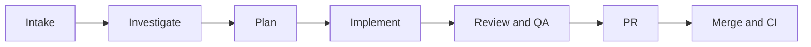

# Issue and report templates

## Issue body (create, or append to the source issue)

Redact secrets and customer data before posting.

~~~markdown
## Outcome
<user-visible outcome>

## Implementation summary
<what changed, in brief>

## Implementation
- Branch: `<branch>`
- Plan: `<relative path to specs/<feature>/plan.md>`
- Mode: `<stable|beta|both>`
- Route: `<feature|bugfix>`
- PR: `<url once created>`
- Promotion PR: `<url, only with --both>`

## Acceptance criteria
- [ ] <criterion from the plan>

## Pipeline state
- [x] Worktree and branch created or reused
- [ ] Investigation (research, debug) or skipped with a reason
- [ ] Plan reviewed, decisions recorded as `delegated (cf:vibe)`
- [ ] Implementation complete
- [ ] Local review passed
- [ ] Tests (conditional) and docs (conditional)
- [ ] PR reviewed and fixed, affected Verification Plans rerun
- [ ] Merged and CI green (only with --ship)
~~~

## Completion report

~~~markdown
**Vibe Result**
- Source: <issue or request>
- Branch/worktree: <branch> | <path>
- Plan: <relative path>
- Issue: <url>
- PR: <url> (the beta-stage PR with --both)
- Promotion PR: <url | n/a>
- Mode: stable|beta|both
- Route: feature|bugfix
- Review: <verdict and fix rounds>
- Merge: skipped|merged|blocked (per stage with --both)
- CI: green|failed|blocked (per stage with --both)
- Research: run (<topics>) | skipped (<reason>)
- Debug: run (root cause proven) | skipped (<reason>)
- Test: run (<what>) | skipped (<reason>)
- Docs: updated | follow-up in Human Next Steps | skipped (<reason>)
- Delegated decisions: <every delegated (cf:vibe) decision recorded in plan.md, or none>

### Journey Diagram

### Implementation Summary
- <concrete changes shipped>

### Plan Deviations
- <deviation and reason, or None>

### Review verdict and severity counts
- Verdict: <Approved | Changes applied>
- Findings: <0 Critical / 0 High / N Medium, resolved X/Y>; counts come from the review, never fabricated

### Human Next Steps
- [ ] <follow-up check, deploy watch, or next task>

Unresolved questions:
- None
~~~
